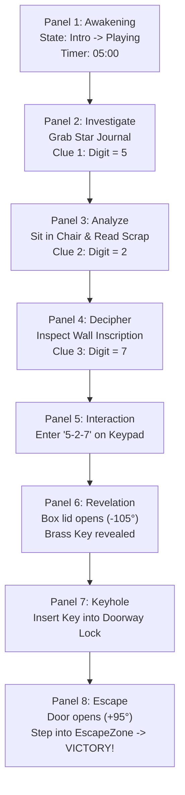

# VR Story Game: 8-Panel Narrative Storyboard
**Project:** VR Escape Room Story Game  
**Scene:** `EscapeRoom.unity`  
**Target Hardware:** VR Headsets (Meta Quest / PCVR via XR Interaction Toolkit) + Desktop Fallback  
**Tone & Atmosphere:** Atmospheric Mystery / Tactile Puzzle Adventure  

---

## Storyboard Overview Matrix (Panels 1 - 8)

| Panel | Scene Title | Core Action / Mechanic | Key Props & Environment | Narrative Beat |
| :---: | :--- | :--- | :--- | :--- |
| **01** | **The Cold Awakening** | VR Spawn, 360° Gaze, HUD Activation | Stone chamber, moonlight, floating HUD | Disorientation & Timer Countdown begins |
| **02** | **The Celestial Tome** | XR Grab, Clue Inspection UI | Bookshelf, *Celestial Star Journal* | Deciphering Clue 1 (First Digit = **5**) |
| **03** | **The Study & Diary Scrap** | Sit mechanic, tactile parchment reading | Wooden table, chair, oil lantern, note | Deciphering Clue 2 (Second Digit = **2**) |
| **04** | **The Ancient Inscription** | Movement / Gaze, deciphering wall carving | South stone wall, chiseled masonry glyphs | Deciphering Clue 3 (Third Digit = **7**) |
| **05** | **The Combination Lock** | XR Poke / Direct button press interaction | Wooden box, 3x4 digital keypad, cyan LCD | Entering the secret passcode (**5 - 2 - 7**) |
| **06** | **The Relic Unsealed** | Animated lid opening, particle emission | Box hinge, golden light ray, brass key | Mechanical revelation & reward |
| **07** | **The Glowing Keyhole** | XR Grab brass key, aiming for keyhole | Heavy wood door, brass lockplate, escutcheon | Tension climax at the locked threshold |
| **08** | **Into the Light (Escape)** | Key insertion, swinging door, zone trigger | Sunlight portal, open threshold, Victory HUD | Triumph, freedom & final score calculation |

---

## Detailed Scene-by-Scene Storyboard Breakdown

### Panel 1: Awaken — The Cold Awakening
- **Camera / VR Perspective:** 
  - First-person VR eye level (1.60m standing height).
  - Field of View: Full stereo 110° HMD view with visible virtual hands (controllers).
- **Visual Composition & Lighting:**
  - Gloomy 8x8m abandoned masonry chamber.
  - Pale blue moonlight streaming through high rafters, casting long shadows.
  - In front of the player, a semi-transparent dark glass world-space UI canvas softly illuminates with cyan text: *"VR ESCAPE ROOM CHALLENGE - Find the combination and escape before time runs out!"*
- **Player Actions & Mechanics:**
  - Player raises virtual hands to calibrate tracking.
  - Countdown timer activates (`05:00` ticking downward via [`TimerManager.cs`](file:///d:/vr%20story%20game/Assets/Scripts/TimerManager.cs)).
  - Player scans 360° around the room, spotting the study table, the tall bookshelf, and the monolithic exit door.
- **Audio & Haptics:**
  - Eerie low-frequency ambient drone with gentle room reverberation.
  - Faint, rhythmic mechanical clock tick emphasizing urgency.
  - Subtle controller vibration pulse as HUD boots up.
- **Underlying Scripts:**
  - [`GameManager.cs`](file:///d:/vr%20story%20game/Assets/Scripts/GameManager.cs) (`StartGame()`), [`UIManager.cs`](file:///d:/vr%20story%20game/Assets/Scripts/UIManager.cs), [`TimerManager.cs`](file:///d:/vr%20story%20game/Assets/Scripts/TimerManager.cs).

---

### Panel 2: Investigate — The Celestial Tome
- **Camera / VR Perspective:**
  - Medium close-up facing the towering wooden bookshelf in the northwest corner (`x=-3.85, z=1.2`).
- **Visual Composition & Lighting:**
  - Dark carved oak bookshelf with leather-bound volumes.
  - A distinct celestial book glows with a subtle warm highlight when the player's hand hovers nearby.
- **Player Actions & Mechanics:**
  - Player reaches out and grabs the *Celestial Star Journal* (`Clue_1_Book_Of_Stars`) using the controller grip trigger ([`XRInteractableAdapter.cs`](file:///d:/vr%20story%20game/Assets/Scripts/XRInteractableAdapter.cs)).
  - Physical object is brought close to the face; the Clue Inspection magnifying HUD pops up:
    > *"Astronomer's Note: The sacred star has 5 golden points. [First Digit = 5]"*
- **Audio & Haptics:**
  - Crisp rustle of old leather and parchment on grab.
  - Soft resonant chime on clue revelation.
- **Underlying Scripts:**
  - [`ClueInteraction.cs`](file:///d:/vr%20story%20game/Assets/Scripts/ClueInteraction.cs) (`InspectClue()`), [`SoundManager.cs`](file:///d:/vr%20story%20game/Assets/Scripts/SoundManager.cs).

---

### Panel 3: Analyze — The Study Desk & Diary Scrap
- **Camera / VR Perspective:**
  - Transition from standing (1.60m) to seated eye level (1.05m / 0.92m) as player sits down in front of the rustic desk.
- **Visual Composition & Lighting:**
  - Warm golden amber cast from the desktop oil lantern illuminating wood grain, scattered ink bottles, and an open parchment page.
- **Player Actions & Mechanics:**
  - Player clicks/interacts with the wooden chair to smoothly seat themselves using [`ChairController.cs`](file:///d:/vr%20story%20game/Assets/Scripts/ChairController.cs).
  - Player picks up `Clue_2_Parchment_Note` resting on the desk:
    > *"DIARY NOTE: How many eyes behold this room? How many ears listen in the dark? [Second Digit = 2]"*
  - Player stores the riddle clue in mind, feeling immersed in the private study atmosphere.
- **Audio & Haptics:**
  - Wooden legs scraping over stone floor as chair slides into position.
  - Crackle and soft flicker of lantern flame.
- **Underlying Scripts:**
  - [`ChairController.cs`](file:///d:/vr%20story%20game/Assets/Scripts/ChairController.cs) (`SitDown()`), [`ClueInteraction.cs`](file:///d:/vr%20story%20game/Assets/Scripts/ClueInteraction.cs).

---

### Panel 4: Decipher — The Ancient Inscription
- **Camera / VR Perspective:**
  - Eye-level perspective standing by the South wall (`x=1.8, z=-4.08`), near the reinforced door frame.
- **Visual Composition & Lighting:**
  - Heavy weathered stone masonry with deeply chiseled runic markings and Latin inscriptions.
  - Soft rim light glancing off the stone relief, highlighting the carved numerals.
- **Player Actions & Mechanics:**
  - Player stands up from the desk and navigates to the carved stone tablet on the wall.
  - Inspects the inscription directly:
    > *"Chiseled Wall Inscription: Seven days to walk the earth. Seven wonders of the old world. [Third Digit = 7]"*
  - The puzzle clicks in the player's mind: **Digit 1 = 5, Digit 2 = 2, Digit 3 = 7 → Passcode: `527`**.
- **Audio & Haptics:**
  - Measured footfalls on cobblestone floor.
  - Light mystical chime indicating all 3 digits have been discovered.
- **Underlying Scripts:**
  - [`ClueInteraction.cs`](file:///d:/vr%20story%20game/Assets/Scripts/ClueInteraction.cs) (`Clue_3_Wall_Carving`).

---

### Panel 5: Interaction — The Keypad on the Box
- **Camera / VR Perspective:**
  - Direct hands-on first-person view, looking down at the heavy wooden box on the desk (`x=0, y=0.88, z=0.5`).
- **Visual Composition & Lighting:**
  - Intricate wooden chest with brass corner brackets.
  - Angled 3x4 mechanical keypad housing with glowing cyan LCD screen displaying `_ _ _`.
- **Player Actions & Mechanics:**
  - Player uses index finger / VR pointer to press buttons sequentially: **'5'**, **'2'**, **'7'** ([`KeypadButton.cs`](file:///d:/vr%20story%20game/Assets/Scripts/KeypadButton.cs)).
  - Buttons depress with physical travel and light up; screen updates in real time to display `5 2 7`.
- **Audio & Haptics:**
  - Satisfying tactile micro-click on each button press.
  - Sharp ascending electronic confirmation bleeps. Controller haptic tick on each contact.
- **Underlying Scripts:**
  - [`KeypadController.cs`](file:///d:/vr%20story%20game/Assets/Scripts/KeypadController.cs) (`OnButtonPressed()`), [`KeypadButton.cs`](file:///d:/vr%20story%20game/Assets/Scripts/KeypadButton.cs).

---

### Panel 6: Revelation — The Relic Box Unsealed
- **Camera / VR Perspective:**
  - Over-the-desk cinematic perspective focused on the opening chest.
- **Visual Composition & Lighting:**
  - Keypad screen flashes bright emerald green displaying `"OPEN"`.
  - Chest lid pivots backward (-105° smoothly).
  - Volumetric warm amber/gold light pours from within the velvet-lined interior, revealing an antique brass key floating with an ethereal glow.
- **Player Actions & Mechanics:**
  - Player observes the mechanical transformation as [`BoxController.cs`](file:///d:/vr%20story%20game/Assets/Scripts/BoxController.cs) unlocks.
  - Key collider and grab interactable are enabled for pickup.
- **Audio & Haptics:**
  - Heavy mechanical deadbolt unlatch *CLACK*.
  - Smooth wooden hinge creak accompanied by a rewarding harmonic chime.
- **Underlying Scripts:**
  - [`BoxController.cs`](file:///d:/vr%20story%20game/Assets/Scripts/BoxController.cs) (`UnlockBox()`), [`SoundManager.cs`](file:///d:/vr%20story%20game/Assets/Scripts/SoundManager.cs).

---

### Panel 7: Keyhole — The Final Threshold
- **Camera / VR Perspective:**
  - First-person view facing the imposing South wooden exit door (`x=0, z=-4.25`).
  - Right VR hand is holding the ornate brass key out in front.
- **Visual Composition & Lighting:**
  - Thick iron-studded timber door panel.
  - Prominent brass escutcheon plate with high-contrast black slot, glowing yellow rim, and embossed `"KEYHOLE"` label.
  - Brass key in hand emits a warm localized point light onto the lockplate.
- **Player Actions & Mechanics:**
  - Player walks towards the exit, bringing the brass key into alignment with the door's keyhole trigger ([`DoorKeyholeTrigger.cs`](file:///d:/vr%20story%20game/Assets/Scripts/DoorKeyholeTrigger.cs)).
  - As the key tip enters the socket trigger, it snaps in place with a satisfying lock engagement.
- **Audio & Haptics:**
  - Subtle metallic rattle and chime while holding the key.
  - Rising string swell and rapid clock ticking as remaining time runs low, spiking dramatic tension.
- **Underlying Scripts:**
  - [`KeyController.cs`](file:///d:/vr%20story%20game/Assets/Scripts/KeyController.cs), [`DoorController.cs`](file:///d:/vr%20story%20game/Assets/Scripts/DoorController.cs), [`DoorKeyholeTrigger.cs`](file:///d:/vr%20story%20game/Assets/Scripts/DoorKeyholeTrigger.cs).

---

### Panel 8: Escape — Into the Light & Freedom
- **Camera / VR Perspective:**
  - Wide first-person perspective as the door swings open 95° outwards.
- **Visual Composition & Lighting:**
  - Intense volumetric golden daylight (exterior sunlight intensity 6.0f) floods through the doorway, washing away the dark shadows of the room.
  - Green outdoor foliage and open horizon visible through the doorway.
  - Large celebratory World-Space UI pops up: *"VICTORY! ESCAPED! Final Time: MM:SS | Score: 1000 pts"*.
- **Player Actions & Mechanics:**
  - Player steps forward across the doorway threshold into the [`EscapeZone.cs`](file:///d:/vr%20story%20game/Assets/Scripts/EscapeZone.cs).
  - Escape trigger fires `WinGame()`: timer freezes, score calculates with speed bonuses, and replay button unlocks.
- **Audio & Haptics:**
  - Heavy mechanical lock tumbling open, followed by a deep wooden door swing sound.
  - Triumphant full orchestral victory fanfare ([`SoundManager.PlayVictory()`](file:///d:/vr%20story%20game/Assets/Scripts/SoundManager.cs)).
  - Ambient outdoor breeze and birds chirping replacing the oppressive room drone.
- **Underlying Scripts:**
  - [`DoorController.cs`](file:///d:/vr%20story%20game/Assets/Scripts/DoorController.cs), [`EscapeZone.cs`](file:///d:/vr%20story%20game/Assets/Scripts/EscapeZone.cs), [`GameManager.cs`](file:///d:/vr%20story%20game/Assets/Scripts/GameManager.cs) (`WinGame()`), [`ScoreManager.cs`](file:///d:/vr%20story%20game/Assets/Scripts/ScoreManager.cs).

---

## Technical Flow & State Transition Diagram

